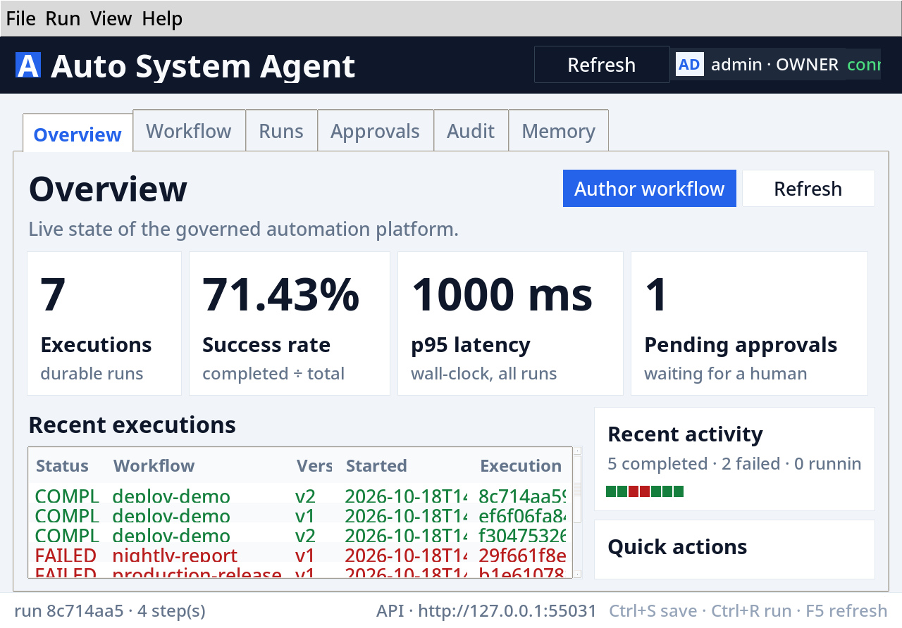
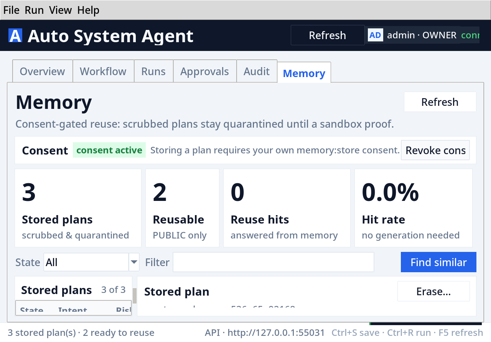
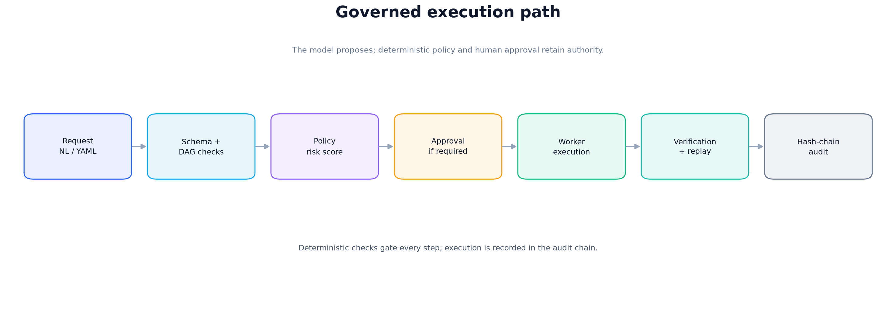

# Team Automation Hub

A governed, event-driven platform for safe operating-system automation: natural-language or YAML requests become validated, policy-checked, approved, auditable execution plans.



`Python 3.10+` · `FastAPI` · `Redis Streams` · `SQLite` · Software engineering capstone · Release candidate

## At a glance

| | |
|---|---|
| **Thesis** | The AI proposes; deterministic project-owned logic disposes; the repository remembers |
| **Pipeline** | Schema/DAG validation → risk & authorisation policy → approval → event-driven workers → verification → hash-chain audit → replay |
| **LLM role** | Optional planner fallback only — never the authority for authorisation, risk, execution or audit |
| **Verification** | **1181 passed, 2 skipped, 767 subtests** (project release report); live four-tab workbench walkthrough |
| **Coverage** | 81.35% global / 86.55% core (project report) |
| **Interfaces** | REST API, Tk workbench (overview, workflow, runs, approvals, audit, memory), Docker Compose |
| **Role** | Team project with Alireza Refahifard — architecture, engine, safety, audit, UI |

## Overview

Automating system operations with an LLM is easy to demo and hard to make safe. This project starts from the opposite end: every request is compiled into a versioned plan, checked against a frozen schema and DAG rules, scored by a deterministic policy engine, and — when risk demands it — held for human approval. Execution happens in workers over Redis Streams, each step is persisted before acknowledgement, and every decision is appended to a hash-chained audit log that can be verified and replayed.

The result is a system where the model can be wrong without making the platform unsafe. It is the Software Engineering capstone of Amir Khoshdel Louyeh (557530) and Alireza Refahifard (557192), supervised by Prof. Distefano, October 2026.

## Screenshot



The workbench shows execution counts, success rate, p95 latency and pending approvals at a glance, with drill-down into runs, the audit chain and memory reuse. The capture above switches to the memory/consent view; the overview is at the top of this README.

## Architecture

```text
Natural language / YAML
        │
        ▼
Planner (offline rules; optional typed LLM adapter)
        │
        ▼
Schema + DAG validation ──► policy engine (ALLOW / NEED_APPROVAL / DENY)
        │                              │
        │                              ▼
        │                     approval quorum + expiry
        ▼
Redis Streams producer ──► consumer groups ──► workers
        │                                      (shell, approval, GUI stubs)
        ▼
Step state persisted before ack ──► hash-chain audit ──► replay
        │
        ▼
SQLite (runs, versions, approvals, memory, audit)
```



The same path applies to natural-language and YAML requests: schema/DAG validation and deterministic policy gate execution, approval is mandatory when risk requires it, and every step is recorded in the audit chain.

**Design boundaries**

- **Planner is untrusted.** Its output must pass the same loader, validator and policy path as hand-written YAML.
- **Policy is deterministic and versioned.** Risk scores, reasons, quorum and policy version are recorded with each decision.
- **Execution is fail-closed.** A command without OS isolation is refused; sandbox paths are relative-only and bounded by timeout, memory and output size.
- **Audit is append-only.** Canonical payloads, sequence numbers and optional anchoring make a full-chain rewrite detectable.
- **Memory requires consent.** Plans are PII-scrubbed before persistence, and reuse never returns the raw value.

## What is implemented

| Area | Evidence |
|---|---|
| Authentication & roles | 401/403 integration tests, OWNER/ADMIN roles, checksum-tracked migrations |
| Workflow DSL | Valid/invalid fixtures, precise 422 diagnostics with stage/line/column |
| DAG engine | Concurrent nodes, timeout, retry, propagation, reverse compensation |
| Policy & approvals | ALLOW/NEED_APPROVAL/DENY, score/reasons/quorum/expiry state machine |
| Event bus | Frozen 5-type contract, consumer groups, idempotency, ordering, DLQ |
| Audit & replay | Paginated audit, timeline, chain verification, tamper detection, replay diff |
| Planner | Deterministic intents/slots, measured held-out accuracy in `docs/PLANNER_EVAL.md` |
| Memory & reputation | Consent-gated writes, PII scrubbing, quarantine → sandbox → public promotion |
| Sandbox | `bwrap` namespaces with audit-hook fallback; escape vectors denied |
| Operations | Prometheus metrics, CI p95 gate, retention, backups, audit anchoring, chaos tests |

Detailed evidence lives in [`docs/IMPLEMENTATION_STATUS.md`](docs/IMPLEMENTATION_STATUS.md), [`docs/ARCHITECTURE.md`](docs/ARCHITECTURE.md), [`docs/SECURITY_REPORT.md`](docs/SECURITY_REPORT.md) and the reports under `docs/reports/`.

## Quickstart

```bash
python -m venv .venv && source .venv/bin/activate
pip install -r requirements.txt -r requirements-api.txt -r requirements-dev.txt

python -m pytest tests          # full hermetic suite
python main.py                  # API + auto-login + four-tab workbench
```

`python main.py` probes `GET /health`, starts the API on `127.0.0.1:8000` if nothing is listening, logs in with the development credentials `admin/admin`, and opens the workbench. Use `--server-only` for the API alone.

Docker Compose variants are provided in `compose.yml` (development) and `compose.prod.yml` (refuses to start without secrets, non-root, database/Redis unpublished).

## Quality gates

```bash
ruff check . && ruff format --check .
mypy src
pytest --cov
bandit -r src
pip-audit -r requirements.txt
```

The release report records 1083 passed + 2 skipped, 81.35% global / 86.55% core coverage, worst endpoint p95 31.5–36.4 ms against a 300 ms NFR, Bandit clean at medium+, and a clean compose build. These figures come from the project's exported reports; re-running the full suite is the way to reproduce them locally.

## Project layout

```text
src/
  engine/       # DAG runner, versions, replay
  safety/       # policy engine, risk scoring, approvals
  storage/      # SQLite, migrations, audit chain, retention, anchors
  bus/          # Redis Streams producer/consumer/workers
  sandbox/      # bwrap isolation, command validation, limits
  planner/      # offline intents/slots, optional LLM adapter
  app/          # FastAPI routes, auth, metrics export
  memory/       # consent, scrubbing, reputation, reuse
docs/           # architecture, ADRs, threat model, reports, demo script
assets/readme/  # README screenshots and diagrams
tests/          # unit, integration, acceptance, chaos
```

## Limitations

- **Team project.** The README does not attribute every module to one author; see [`docs/AI_USAGE_LOG.md`](docs/AI_USAGE_LOG.md) and the proposal for contribution records.
- **Human tasks remain open.** The SUS usability study (five sessions) and the demo recording are labelled PENDING in the project's own status document.
- **Sandbox strength depends on the host.** `bwrap` is the primary layer; the audit-hook fallback is weaker and refuses commands rather than pretending isolation.
- **Local scale.** SQLite and a single Redis instance target one deployment; horizontal scaling and multi-tenant isolation are future work.
- **LLM adapter is optional and non-authoritative.** No hosted-model evaluation is reported.
- **The full 1181-test run was not repeated in this documentation pass.** The numbers above are from the project's release reports and status document.

## Documentation

- [`docs/ARCHITECTURE.md`](docs/ARCHITECTURE.md) — components and data flow
- [`docs/ADR.md`](docs/ADR.md) — 10 architecture decisions with rejected alternatives
- [`docs/THREAT_MODEL.md`](docs/THREAT_MODEL.md) — STRIDE, trust boundaries, residual risk
- [`docs/PERF_REPORT.md`](docs/PERF_REPORT.md) — measured latency and throughput
- [`docs/DEMO_SCRIPT.md`](docs/DEMO_SCRIPT.md) — three-minute walkthrough
- [`docs/LIMITATIONS.md`](docs/LIMITATIONS.md) — deferred features and known gaps

## Tech stack

`Python` · `FastAPI` · `pydantic` · `SQLite` · `Redis Streams` · `bwrap` · `Tkinter` · `pytest` · `ruff` / `mypy` / `bandit` / `pip-audit` · `Docker Compose` · GitHub Actions

## Authors

**Amir Khoshdel Louyeh** (557530) · **Alireza Refahifard** (557192)
[GitHub](https://github.com/amir-khoshdel-louyeh) · [LinkedIn](https://www.linkedin.com/in/amir-khoshdel-louyeh)
