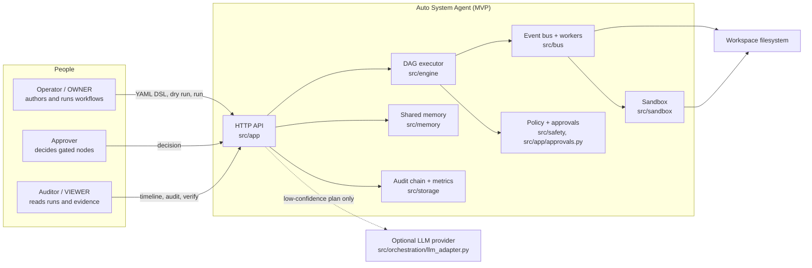
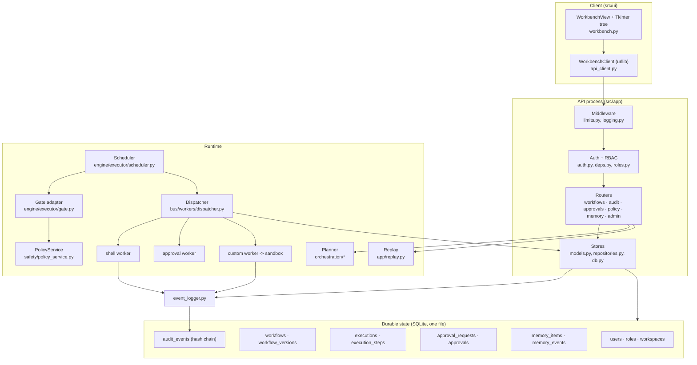
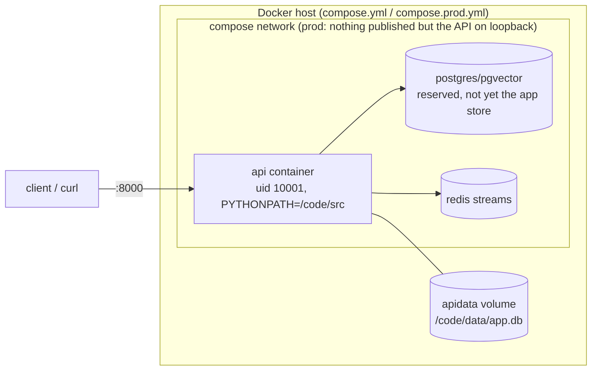
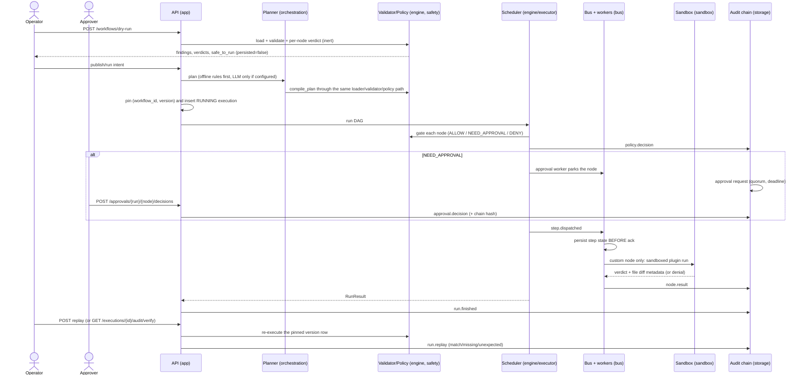
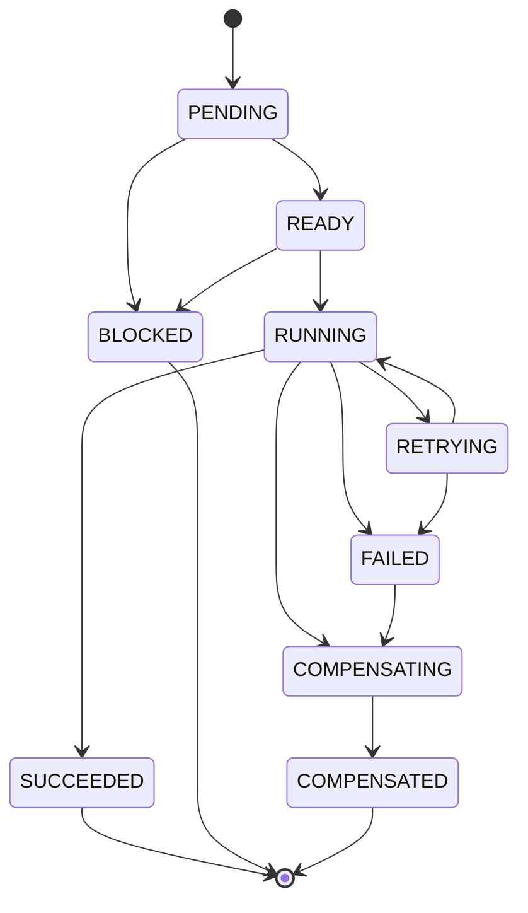
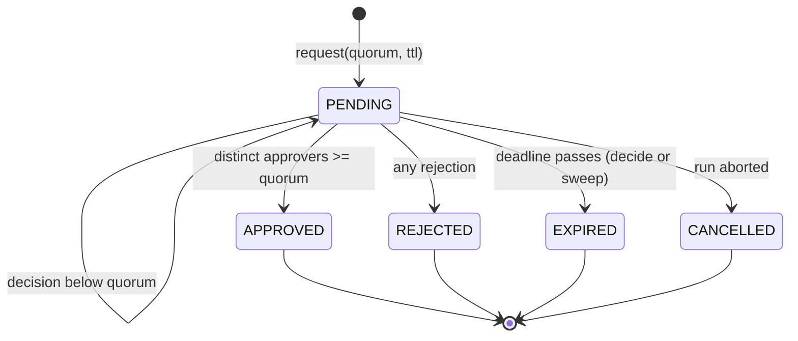
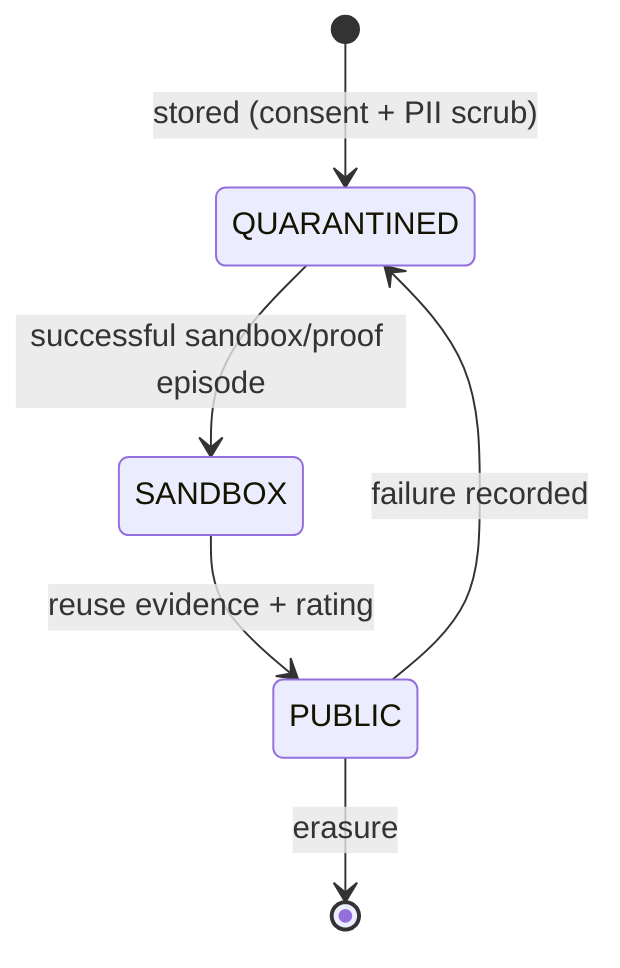
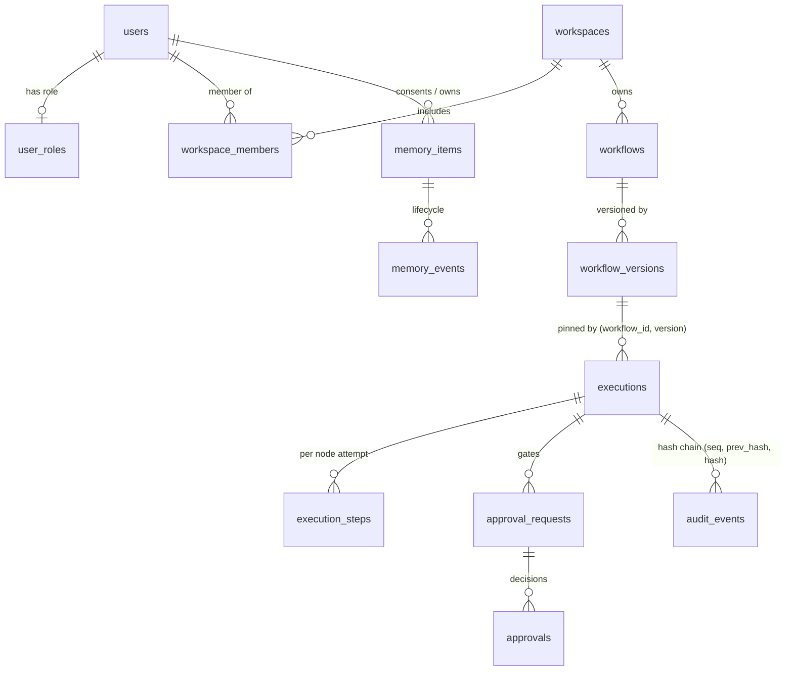

# Architecture (Phase 10 item [90])

Diagrams are Mermaid so they render in the repository view and can be diffed
like code. Every box names the module that implements it; every state machine
is copied from the frozen vocabulary in `src/engine/executor/states.py` and
`src/app/approvals.py`, not invented for the picture.

---

## 1. System context

## 2. Components

## 3. Deployment view

## 4. Sequence: run a planned workflow, pause for approval, replay

## 5. State machines

### 5.1 Node/step lifecycle (`src/engine/executor/states.py`)

### 5.2 Approval request (`src/app/approvals.py`)

### 5.3 Memory item (`src/memory/states.py`)

## 6. Data model (SQLite, migrations 001–007)

## 7. Layer rules the code keeps

| Layer | Directory | May depend on | Must not |
|---|---|---|---|
| Client | `src/ui`, `main.py` | HTTP API only | import engine/safety/bus logic; hold business rules |
| API | `src/app` | engine, safety, storage, bus, memory, orchestration | execute OS commands itself |
| Engine | `src/engine` | safety, storage | touch the network or the client |
| Safety | `src/safety` | pure data | call the executor (policy decides, it does not run) |
| Bus/workers | `src/bus` | engine gate, sandbox, storage | trust a producer's verdict; skip durable state before ack |
| Sandbox | `src/sandbox` | stdlib only | import app code; run without isolation |
| Storage | `src/storage` | stdlib, sqlite | import UI or engine |

`docs/THREAT_MODEL.md` analyses the trust boundaries these rules create, and
`tests/unit/test_threat_model_doc.py` fails if a cited file moves.

## 8. Reading order for a reviewer

1. `docs/ARCHITECTURE.md` (this file) — the shape.
2. `docs/TRACEABILITY.md` — which requirement is proven where.
3. `docs/ADR.md` + `docs/RISK_REGISTER.md` — why it is shaped this way, and
   what is still exposed.
4. `docs/SECURITY_REPORT.md` + `docs/THREAT_MODEL.md` — the risk story.
5. `docs/DEPLOYMENT.md` + `docs/PERF_REPORT.md` — how it runs and how fast.
6. `docs/LIMITATIONS.md` — what it deliberately does not do.
