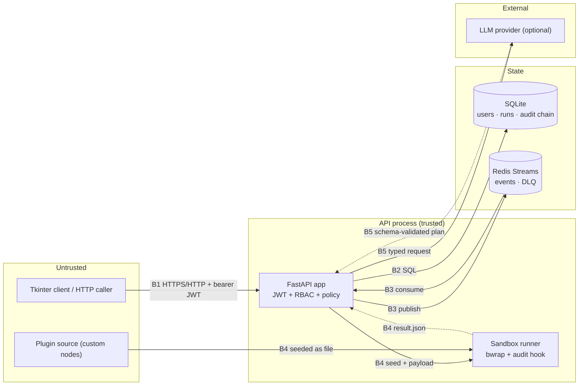

# STRIDE threat model

**Item:** Phase 9 — [81] Complete STRIDE threat model
**Scope:** the MVP as deployed by `compose.yml` (API, SQLite auth/run store,
Redis Streams bus, sandboxed plugins, Tkinter client) and the optional LLM
adapter. Stretch features (OAuth, web client, Kubernetes, multi-platform GUI)
are out of scope and marked as such.
**Method:** data-flow decomposition, STRIDE per element and trust boundary,
one mitigation and one piece of evidence per threat. A threat without code
*and* a test is listed as residual, not mitigated.

---

## 1. Assets

| # | Asset | Why it matters | Where it lives |
|---|---|---|---|
| A1 | JWT signing key (`SECRET_KEY`) | forging any role, including OWNER | environment only (`src/app/settings.py`) |
| A2 | Admin / user credentials | full control of the workspace | `users` (PBKDF2-SHA256, 200k iterations) |
| A3 | Role and membership data | who may run, approve, read | `users`, `user_roles`, `workspaces`, `workspace_members` |
| A4 | Workflow versions and run records | the automation contract and its history | `workflows`, `workflow_versions`, `executions`, `execution_steps` |
| A5 | Audit hash chain | accountability evidence; tamper detection | `audit_events` |
| A6 | Approval decisions | human authorisation for risky nodes | `approval_requests`, `approvals` |
| A7 | Shared memory (plans, ratings) | reuse quality; may contain user text | `memory_items`, `memory_events` (PII-scrubbed) |
| A8 | Plugin source and sandbox workspace | untrusted code execution | `plugins/`, disposable temp tree |
| A9 | LLM provider key and prompts | cost, data egress | environment only, optional adapter |
| A10 | Logs and metrics | operations; must not leak secrets | stdout / metrics endpoints |

## 2. Trust boundaries and data flow

| Boundary | Crosses | Control at the boundary |
|---|---|---|
| B1 | client → API | bearer JWT (`decode_token`), RBAC dependency (`require_permission`), schema validation (pydantic), body-size and rate limits |
| B2 | API → SQLite | parameterised SQL everywhere, one file per environment, append-only audit inserts |
| B3 | API ↔ Redis | closed event schema, correlation + idempotency key, step persisted before ack |
| B4 | API → sandbox | frozen `sandbox-v1` contract, namespace isolation or audit hook, resource limits, sentinel directory outside the workspace |
| B5 | API → LLM | optional, typed adapter, timeout/retry, schema validation, no secret in metadata |

## 3. STRIDE analysis

### 3.1 Boundary B1 — client to API

| STRIDE | Threat | Mitigation | Evidence |
|---|---|---|---|
| **S**poofing | A caller forges a token to become OWNER | HS256 signature with a server-side key; `alg` not taken from the token; unknown role fails closed | `src/app/security.py::decode_token`, `tests/unit/test_app_security.py`, `tests/integration/test_app_auth.py` |
| **S**poofing | Credential stuffing against `/auth/login` | PBKDF2 verification + per-client login rate limit (10/min, refunded on success) | `src/app/limits.py`, `tests/integration/test_rate_limit_api.py` |
| **T**ampering | Client rewrites a workflow/steps to skip approval | Server re-validates DSL and re-decides policy; client input is data, never a verdict | `src/engine/validator/validator.py`, `src/safety/dryrun.py`, `tests/unit/test_engine_phase1.py` |
| **T**ampering | Oversized/malformed bodies exhaust the process | pydantic bounds per field + 1 MiB request cap (413) + rate limit (429) | `src/app/limits.py`, `tests/integration/test_rate_limit_api.py` |
| **R**epudiation | Caller denies having cast an approval | Decision rows store approver, verdict, reason, timestamp, and append to the execution's hash chain | `src/app/approvals.py`, `tests/unit/test_audit_trail.py` |
| **I**nformation disclosure | Unauthorised read of runs/audit/approvals | RBAC on every route (`run:read`, `audit:read`, `approval:decide`) | `src/app/deps.py`, `tests/integration/test_app_rbac.py`, `tests/integration/test_approvals_api.py` |
| **I**nformation disclosure | Tokens/secrets leak through logs | JSON access log carries method/path/status/duration only; redaction filter masks `authorization`, `password`, `token`, `api_key`, `secret` and bearer strings | `src/app/logging.py`, `tests/unit/test_log_redaction.py` |
| **D**enial of service | Request flood | Token bucket per client with `Retry-After`; health probe unlimited | `src/app/limits.py`, `tests/unit/test_rate_limit.py` |
| **E**levation of privilege | VIEWER decides an approval or edits a workflow | Permission matrix checked in the route dependency *and* the service; `approval:decide` excludes VIEWER/OPERATOR | `src/app/roles.py`, `tests/integration/test_approvals_api.py::test_viewer_cannot_decide` |

### 3.2 Boundary B2 — API to SQLite

| STRIDE | Threat | Mitigation | Evidence |
|---|---|---|---|
| **T**ampering | SQL injection through filters | Parameterised statements only; no string-built predicates with caller values | `src/app/models.py`, `src/storage/audit.py` |
| **T**ampering | Edited or deleted audit row | Canonical payload hash chain; verification names the first broken seq | `src/storage/audit.py::verify_chain`, `tests/unit/test_audit_chain.py` |
| **T**ampering | Schema drift between machines | Checksum-tracked migration runner; edited migration refuses to apply | `src/app/db.py::apply_migrations`, `tests/integration/test_app_migration.py` |
| **I**nformation disclosure | DB file readable by another local user | File created under `SQLITE_PATH`; deployment runs the API as its own container user; production compose mounts a private volume | `compose.yml`, `docs/SECURITY_REPORT.md` |
| **D**enial of service | Growth of run/step/audit tables | Bounded list endpoints (`limit <= 500`), page offsets, 1 MiB file-size limit in the sandbox | `src/app/audit_api.py`, `src/sandbox/runner.py` |
| **E**levation of privilege | Caller writes a role/membership row through an API filter | No route accepts a caller-supplied role or scope identifier; roles come from the verified JWT claim and memberships only from the OWNER-only admin routes | `src/app/admin.py`, `src/app/deps.py`, `tests/integration/test_app_rbac.py` |
| **R**epudiation | A run is claimed without evidence | `run.started`/`run.finished`, per-node dispatch/result events written by the run path | `src/bus/workers/dispatcher.py`, `tests/integration/test_audit_run_path.py` |

### 3.3 Boundary B3 — API to Redis Streams

| STRIDE | Threat | Mitigation | Evidence |
|---|---|---|---|
| **S**poofing | Another publisher injects a step event | Worker only handles the frozen 5-type schema; unknown node types fail closed | `src/bus/events.py`, `tests/unit/test_bus_events.py` |
| **T**ampering | Duplicate or replayed event causes a second side effect | Idempotency key + step state persisted before ack | `src/bus/workers/core.py`, `tests/unit/test_bus_idempotency.py` |
| **R**epudiation | Event processed but not recorded | Persist-before-ack plus audit sink on the execution chain | `tests/unit/test_bus_persist.py`, `tests/integration/test_audit_run_path.py` |
| **I**nformation disclosure | Raw stdout/secrets persisted in events | Workers store bounded summaries (2 000 chars), never raw payloads or secrets | `src/app/models.py::record_step`, `tests/unit/test_bus_workers.py` |
| **D**enial of service | Poison message loops forever | Bounded retries with exponential backoff, then dead-letter stream | `src/bus/consumer.py`, `tests/unit/test_bus_retry.py` |
| **D**enial of service | Unauthenticated Redis on a public port | `compose.yml` publishes Redis for local development only; `compose.prod.yml` requires `REDIS_PASSWORD`, enables `--requirepass` and publishes nothing but the API on loopback | `compose.prod.yml`, `tests/integration/test_production_config.py` |
| **E**levation of privilege | A forged event grants a node permissions it should not have | Workers re-apply policy per node and never trust a producer-supplied verdict; unknown event types are dropped | `src/bus/workers/dispatcher.py`, `tests/unit/test_bus_events.py` |

### 3.4 Boundary B4 — API to sandbox

| STRIDE | Threat | Mitigation | Evidence |
|---|---|---|---|
| **S**poofing | A plugin forges its own verdict | Result file path is outside the workspace and unknown to the plugin; result read after exit | `src/sandbox/harness.py::main`, `tests/acceptance/test_sandbox_isolation.py` |
| **T**ampering | Plugin writes outside its workspace (`..`, absolute, symlink) | Namespace isolation or audit hook resolves real paths and denies | `tests/acceptance/test_sandbox_isolation.py` |
| **T**ampering | Plugin edits the audit chain or other runs | Only the disposable workspace is writable; DB/audit paths are not mounted | `src/sandbox/runner.py::_bwrap_argv` |
| **R**epudiation | Sandbox result silently dropped | Every `custom` step publishes its sandbox verdict (or `step.failed` with the reason) | `src/bus/workers/custom.py`, `tests/integration/test_sandbox_plugins.py` |
| **I**nformation disclosure | Plugin reads `/etc/passwd`, `$HOME/.ssh` | Read allow-list of runtime paths; hidden host secrets not bound into the namespace | `src/sandbox/harness.py::install_guard` |
| **D**enial of service | CPU/memory/disk/process bomb | `RLIMIT_CPU/AS/FSIZE/NOFILE`, wall-clock kill of the process group, no fork/exec/network | `src/sandbox/runner.py::_limits`, `tests/acceptance/test_sandbox_isolation.py` |
| **E**levation | Plugin escapes to the host | Both layers fail closed; `command` kind is refused when namespaces are unavailable | `src/sandbox/runner.py::_plain_argv`, `tests/acceptance/test_sandbox_isolation.py::CommandTests` |

### 3.5 Boundary B5 — API to LLM provider (optional)

| STRIDE | Threat | Mitigation | Evidence |
|---|---|---|---|
| **S**poofing | A different host answers the API call | Provider URL comes from configuration; the adapter validates the response *shape* and falls back to the offline planner | `src/orchestration/llm_adapter.py`, `tests/unit/test_llm_adapter.py` |
| **T**ampering | Model returns a dangerous plan | Output must pass the typed schema, loader, validator and policy — it never executes directly | `src/orchestration/plan_compiler.py`, `tests/acceptance/test_planned_workspace.py` |
| **I**nformation disclosure | API key or prompt leaks into records | Key from environment only; provider metadata stores provider/model/latency/attempts, never the key or raw prompt | `src/orchestration/planner_service.py`, `tests/unit/test_llm_adapter.py` |
| **D**enial of service | Slow or failing provider stalls planning | Timeout + bounded retries + fallback to the offline planner | `src/orchestration/llm_adapter.py` |
| **E**levation | Prompt injection asks for `rm -rf /` | Planned safely then gated: policy returns DENY before dispatch | `tests/unit/test_policy_adversarial.py`, `tests/acceptance/test_planned_workspace.py` |

### 3.6 Operator and deployment surface

| STRIDE | Threat | Mitigation | Evidence |
|---|---|---|---|
| **S**poofing | Deployment ships with `SECRET_KEY=insecure-…` | Production settings refuse the dev secret, short keys and default passwords at startup | `src/app/settings.py::validate`, `tests/unit/test_app_settings.py` |
| **I**nformation disclosure | Secrets committed to the repository | Regex secret scan runs in CI and in the test suite | `scripts/secret_scan.py`, `tests/unit/test_secret_scan.py` |
| **T**ampering | Supply-chain package swap | Pinned ranges, `pip-audit` on every CI run, dependency list reviewed in `docs/THIRD_PARTY_NOTICES.md` | `.github/workflows/ci.yml`, `docs/SECURITY_REPORT.md` |
| **D**enial of service | Host compromise via container escape | Non-root image, no host mounts beyond the code, sandbox is the only place untrusted code runs | `Dockerfile.api`, `compose.yml` |

## 4. Assumptions

1. TLS terminates in front of the API in any non-local deployment; the MVP
   compose file speaks plain HTTP on the loopback/host network.
2. The API is the only writer to its SQLite file; horizontal scaling would
   move state to PostgreSQL first (see `docs/LIMITATIONS.md`).
3. Redis is reachable only from the compose network in a real deployment.
4. Plugin authors are untrusted; the registry, not `sys.path`, decides what
   may run.
5. The operator supplies production secrets through the environment; the
   repository contains only development defaults that production rejects.

## 5. Residual risks (accepted for the MVP)

| Risk | Why it remains | Compensating control | Owner action |
|---|---|---|---|
| Plain HTTP in compose | local demo only | documented, TLS expected at the edge | terminate TLS before any shared deployment |
| Redis without auth | the *development* stack keeps it open for a one-command demo | `compose.prod.yml` requires a password and publishes no broker port | use `compose.prod.yml` for anything shared |
| In-process rate limiting | one API process | per-process buckets; a proxy limit is the multi-replica answer | add edge rate limiting when scaling out |
| Sandbox depends on `bwrap` for `command` nodes | kernel/user-namespace availability | plugin path still guarded by the audit hook; `command` refused without namespaces | keep plugin nodes for untrusted work |
| SQLite single-writer | MVP scope | WAL-free short transactions, low concurrency | migrate to PostgreSQL before horizontal scale |

## 6. How this model stays honest

- Every mitigation above names a file and a test; a change that removes the
  test must update this table in the same commit (`docs/CONVENTIONS.md` §1.3).
- `docs/SECURITY_REPORT.md` records the tool output (Bandit, `pip-audit`,
  secret scan) that backs the supply-chain rows.
- New externally reachable routes must add a row to §3.1 before merge.
